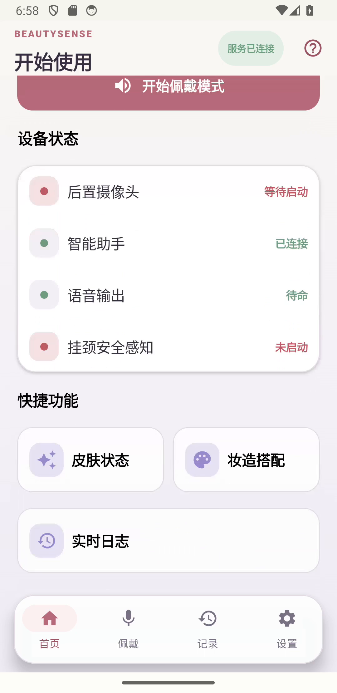
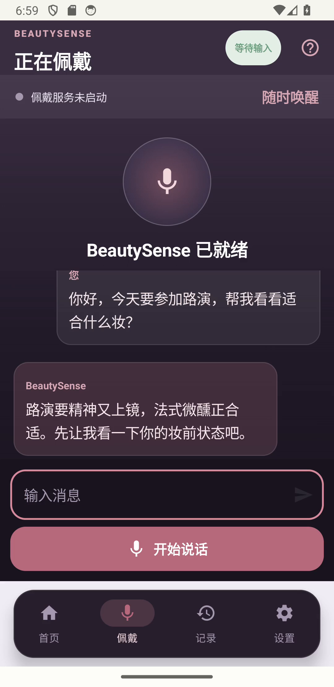
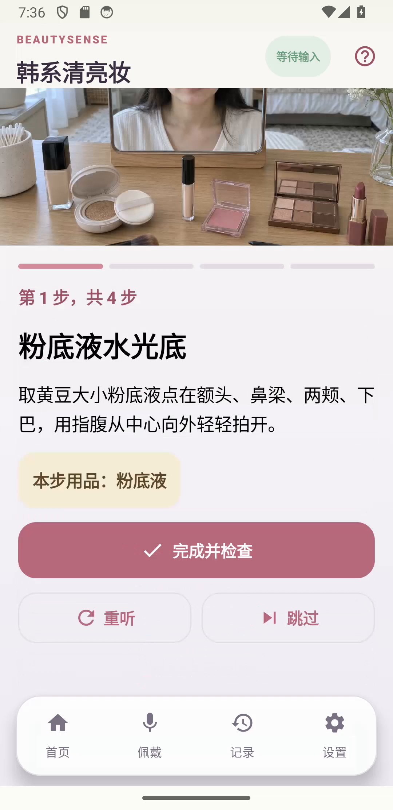

# 妆伴 · BeautySense

当前分支为妆伴 V2 预览版：点击开始进入前置镜面，确认定位后分析皮肤与面部，阅读 AI 解读，分类选择真实 PROYA 珀莱雅产品，再查看随面部变化的生成式妆效。小妆辅助解释与语音操作，核心流程可完全通过点击完成。

详细规则见 [V2 需求文档](docs/superpowers/specs/2026-11-07-beautysense-v2-requirements.md)。下方原 1.2.1 下载与线上空间属于既有稳定版，新版预览 APK 单独交付，不覆盖旧版部署。

## 下载与体验

- [Android App 1.2.1 下载](https://github.com/Karl-XZ/BeautySense/releases/tag/v1.2.1)：Android 8.0 及以上，调试签名测试版。
- [Web 创空间](https://modelscope.cn/studios/Karlzhy/BeautySense)：上传图片、使用摄像头或选择预设画面体验。
- [Web 页面](https://openl.work/BeautySense/)。

Web 版本具备全部功能体验，但是为了最好的使用效果，建议下载 App 使用。也可联系我们试用自研硬件「妆伴魔镜」。

## 功能

- **前置单镜面**：圆框定位、确认分析、结果、选品、实时预览在同一界面完成。
- **联合分析**：可见皮肤状态、面部特点和 LLM 解读。
- **珀莱雅选品**：真实商品图、分类互斥选择、总计至少一款；目前展示官方妆感，不虚构精确色号。
- **实时妆效**：真实图像模型生成后提取透明区域层，用 478 点网格随脸变化，可对照原貌、调整浓淡和清除。
- **辅助小妆**：真实云端 ASR/TTS、文字解释及同一套操作规则，麦克风按需授权。
- **独立会话**：取消、换人、重新分析与退出均使旧请求失效。

图像分析和生成使用服务端模型，密钥不进入客户端。V2 已移除旧版佩戴、找物和分步指导入口。当前开发测试覆盖 PC 浏览器与 Android 模拟器；手机实景验收与上述测试分开记录。

## 源码结构

本仓库主分支提供已发布的原生 Android 客户端源码，基于 Kotlin、Jetpack Compose、CameraX 和 ML Kit。

```text
beautysense/
  src/main/java/com/beautysense/app/
    audio/     # 录音、语音播报和唤醒
    model/     # 方案、步骤与复核数据
    network/   # 妆伴服务接口
    ui/        # Compose 界面与魔镜预览
    vision/    # 人脸裁切与帧缓存
    v2/        # V2 原生界面、状态、接口、前置跟踪与实时纹理
    wear/      # 旧版保留源码，不是 V2 入口
  src/test/          # JVM 单元测试
  src/androidTest/   # 魔镜设备界面测试
  build.gradle
docs/images/         # 妆伴界面演示截图
gradle/              # Gradle Wrapper
.github/workflows/   # Android 构建与测试
```

Web 与模型服务端通过上方体验链接提供；它们的源码不包含在当前主分支。

## 构建 Android App

需要 JDK 17、Android SDK Platform 35 和 Build Tools 35.0.0；Gradle 通过仓库内的 Wrapper 运行。

```powershell
.\gradlew.bat :beautysense:testDebugUnitTest :beautysense:assembleDebug --no-daemon
```

Linux/macOS：

```bash
chmod +x gradlew
./gradlew :beautysense:testDebugUnitTest :beautysense:assembleDebug --no-daemon
```

APK 输出：`beautysense/build/outputs/apk/debug/beautysense-debug.apk`。

V2 服务地址可在首页设置，也可用 `BEAUTYSENSE_SERVER_URL` 构建配置。PC 测试包使用 `http://127.0.0.1:5186`，模拟器连接前执行 `adb reverse tcp:5186 tcp:5186`；连接电脑局域网服务时改填电脑地址。公共部署使用 HTTPS。V2 API 会话使用临时 bearer token，模型密钥由服务端保管。

## 旧版界面存档

| 首页 | 妆造工作室 | 分步指导 |
| --- | --- | --- |
|  |  |  |

更多客户端说明见 [beautysense/README.md](beautysense/README.md)。
