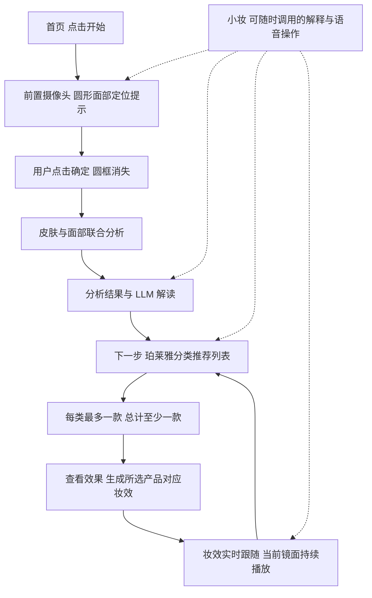

# 妆伴 V2 详细需求文档

版本：1.0

日期：2026年11月7日

适用端：Web、Android APK、使用上述客户端的妆伴魔镜设备

开发分支：`codex/beautysense-v2-live-tryon`

产品范围：仅 PROYA 珀莱雅品牌，不包含彩棠、原色波塔及集团其他品牌。

本文定义新版的产品行为、交互规则、数据要求、技术边界和验收标准，是后续界面设计、开发与测试的共同依据。性能数值均为交付目标，模型能力引用与拟采用的工程方案分别说明。

## 1 产品定位与目标

妆伴 V2 是一款以前置摄像头为主界面的 AI 美妆镜。用户通过点击完成面部与皮肤分析、理解分析结果、选择适合自己的真实珀莱雅产品，并在实时镜面中查看随面部运动的妆效。

小妆提供辅助解释和语音操作。用户不打开小妆、不授予麦克风权限，也能完成全部核心流程；愿意使用语音的用户，可以通过小妆完成相同任务。

核心流程为：

### 1.1 完整体验的判断标准

1. 无语音参与时，用户可从开始一直操作到实时试妆。
2. 不切换到静态照片页，不离开当前镜面完成分析、选品和预览。
3. 分析结果同时覆盖皮肤可见状态和面部特点，并用于解释产品推荐。
4. 推荐商品均属于 PROYA 珀莱雅，图片、名称、版本、色号与资料来源一致。
5. 用户能明确知道选择了哪些商品，且不会同时选中同一分类的多款商品。
6. 试妆结果保留当前用户的身份特征，随实时表情和姿态变化。
7. Web 与 APK 的业务流程、选择约束和产品数据一致。

## 2 版本范围

### 2.1 本版必须交付

| 编号 | 能力 | 交付范围 |
| --- | --- | --- |
| S01 | 单一前置摄像头流程 | 开始、定位、确认、分析、选品、试妆贯通 |
| S02 | 联合分析 | 皮肤可见状态与面部特点同步输出 |
| S03 | LLM 结果解读 | 解释观察结果、选品方向及妆容适配理由 |
| S04 | 真实商品目录 | PROYA 珀莱雅真实商品、官方实图、版本与来源 |
| S05 | 分类选择 | 每类零或一款，所有分类总计至少一款 |
| S06 | 推荐讲解 | 产品作用、成分、质地、适配依据和使用特点 |
| S07 | 生成式妆效 | 依据用户面部、所选商品与官方参考素材生成 |
| S08 | 实时试妆 | 面部跟踪、区域贴合、表情变化、遮挡处理 |
| S09 | 效果比较与调整 | 原貌对照、浓淡调整、改选、更新、清除 |
| S10 | 辅助小妆 | 文字、按键语音输入、语音讲解及等价流程操作 |
| S11 | 会话隔离 | 当前人物、分析、选品和生成任务正确绑定 |
| S12 | 双端交付 | Web 与 APK 同步实现、分别实机验收 |

### 2.2 从新版产品流程中移除

脖挂与佩戴模式、后置摄像头入口、外接设备连接流程、找物、物品位置记忆、拿取导航、分步化妆教学、动作完成检查、补妆纠错步骤、安全事件与求助流程。

上述功能对应的主导航、按钮、语音意图和后台自动任务一起退出新版流程。用户请求这些任务时，小妆说明当前可用功能，不启动旧流程。

首页只承担产品介绍和开始入口；连接信息、权限说明等放在轻量设置中。旧版多页面业务导航不沿用到镜面主流程。

### 2.3 本版不扩展的内容

不增加其他品牌商品、发色或发型更换、购物车与支付、账号社区、长期皮肤档案、医疗诊断、后台持续录像。商品详情可提供官方来源链接，不在本版内完成交易。

## 3 用户与操作原则

### 3.1 点击优先

每个流程节点都有明确可见的按钮。分析、下一步、选择商品、选择色号、查看效果、更换商品、清除效果、重新分析和退出均可直接点击。核心按钮不藏在聊天记录中。

### 3.2 小妆辅助

小妆默认以不遮挡人脸的小入口出现，不自动弹出大面积聊天窗。用户可询问当前结果或产品，也可直接发出操作指令。手动点击和语音操作共享同一个业务状态、校验规则和任务调度。

### 3.3 用户控制关键动作

开始、确认分析、进入推荐、提交试妆由用户发起。小妆可在理解明确语音指令后执行对应动作，但不得因介绍产品自动替用户选择、提交或开始新会话。

### 3.4 镜面连续

完成摄像头授权后，当前镜面在定位、分析、查看结果、选品和生成期间持续播放。仅用户退出、系统挂起、权限撤销或摄像头故障会中断取流。内部读取图像帧不向用户展示为“拍照”。

## 4 主界面与布局

### 4.1 首页

展示妆伴名称、简短用途说明和一个主要按钮“开始”。点击后请求摄像头权限并进入镜面。首页另有次级小妆入口，允许用户主动开启语音后说“开始”，仍执行相同权限与流程。首次使用时告知：面部分析及生成会按所启用能力向服务端提交选取的面部帧，实时显示与跟踪使用本机摄像头画面。

麦克风权限在用户首次使用语音输入时申请，不与摄像头权限捆绑。

### 4.2 镜面结构

| 区域 | 内容与规则 |
| --- | --- |
| 镜面背景 | 实时前置摄像头，按镜子习惯水平翻转 |
| 顶部 | 当前流程阶段、必要状态、返回或退出入口 |
| 中央 | 仅定位阶段显示圆框；后续阶段不固定覆盖大段文字 |
| 底部面板 | 定位确认、结果、选品或试妆控制，按阶段切换 |
| 小妆入口 | 可展开文字或语音辅助，不覆盖核心提交按钮 |

摄像头按原始比例显示，禁止拉伸。默认保留完整原始画幅，比例差异由背景或留白吸收；横竖屏均不以裁掉额头、下巴或有效面部区域换取铺满。

底部内容面板可收起、展开后半透明，文字所在区域保持足够对比度。常规展开高度不超过镜面可用高度的 45%；收起后只保留阶段标签与必要按钮。较长报告、商品详情在面板内部滚动。键盘出现时缩小或上移面板，保留人脸可视区域。

竖屏以底部面板为主，原生 App 或魔镜设备横屏使用侧边半透明面板，以减少遮脸。桌面宽屏 Web 延续既有要求，在中央保留标准手机屏幕比例的体验区，整个新版流程在该区域内完成；去掉正式页面左右两侧的旧模拟控制台，不自行将产品改成铺满桌面的后台面板。独立页面与平台嵌入页均需适配，窄屏时体验区随可用屏幕缩放。具体像素、字体、配色由界面设计阶段统一，不更改本文业务规则。

### 4.3 常驻与阶段按钮

只常驻退出、小妆与面板展开入口。每个阶段突出一个主要动作：定位阶段“确定”，结果阶段“下一步”，选品阶段“查看效果”，试妆阶段“更换产品”。不得同时放置多个含义相近的主按钮。

## 5 进入与面部定位

### 5.1 摄像头规则

只请求前置摄像头。设备有多个前置镜头时优先使用普通视角镜头；不存在前置摄像头时明确说明，不能静默改用后置镜头或测试图片。

用户拒绝权限时显示权限恢复说明及重试入口；授权恢复后可继续，不强迫重装或清除数据。线上 Web 使用支持摄像头权限的安全上下文，嵌入平台需要正确转交摄像头和麦克风权限。

### 5.2 圆形定位提示

初次进入镜面，在中央显示圆形或近圆形面部定位框，文案为“请将面部放入圆框内”。实时检查：单人脸、完整度、距离、清晰度、光线和姿态。圆框只用于拍摄构图辅助，不作为最终皮肤区域遮罩。

检测提示使用具体动作，如“请靠近一点”“请正对镜头”“光线偏暗，请调整位置”。不连续堆叠多条提示，不将检测结果播报为无休止语音。

### 5.3 点击确定

存在一张完整且质量合格的人脸后，“确定”可用。用户点击后圆框立即消失，进入分析。无脸、多人、严重模糊、严重过曝或欠曝时，“确定”不可用，并显示对应提示。

提交分析前，在最多 3 秒内自动选取质量合格的原始帧。若这段时间内失去人脸，返回定位并说明原因，不拿更早的缓存帧冒充本次输入。可以采集少量帧用于稳健分析，但一次确认只创建一个分析任务。

## 6 面部与皮肤联合分析

### 6.1 分析内容

| 维度 | 输出内容 | 与选品的关系 |
| --- | --- | --- |
| 皮肤区域 | 排除眼、唇、头发、背景后的面部皮肤区域 | 限定可见皮肤指标的计算范围 |
| 肤色表现 | 当前光照下的肤色、色调倾向与均匀度 | 为底妆色号和整体配色提供参考 |
| 可见皮肤状态 | 泛红、斑点、毛孔、纹理、细纹等可见表现 | 关联遮盖、质地、润泽度等选品需求 |
| 面部形态 | 脸型及面部比例、眉眼唇的形态特点 | 关联妆容风格与区域效果 |
| 输入质量 | 光线、清晰度、遮挡、姿态、是否已有明显妆容 | 决定哪些结论可展示以及是否重新采集 |

根据实际模型输出展示指标，未输出的指标不由 LLM 补造。出现明显已有妆容时，明确区分“当前可见外观”与裸肤特征；提示可重新清洁后分析，但不强制中止整个体验。

### 6.2 结果呈现

先给出简洁总览，再提供皮肤、面部两个可展开分区。每项结果包含可读名称、观察描述及其选品意义；有真实数值时，必须同时说明量纲或评分含义。

不使用没有算法依据的“皮肤年龄”“水分百分比”“过敏概率”或疾病判断。分析不自动美化原始帧。已有虚拟妆效必须从分析输入中排除。

### 6.3 分析的可用性

至少获得有效面部分析和足以支持选品的可见皮肤观察后，结果进入完成状态。部分维度不可用时具体说明受影响内容，禁止填充默认高分。输入不足以支持推荐时，引导重新采集，不展示伪造完整报告。

### 6.4 重新分析

用户可返回定位重新分析。确认开始新分析后，旧分析、LLM 解读、推荐列表及已生成妆效失效，并清空已选商品，防止旧结果驱动新脸的推荐。重新分析前提示“将重新分析并清空当前选品与试妆效果”，用户可取消。

## 7 LLM 结果解读

### 7.1 输入与职责

LLM 读取结构化分析结果、输入质量、用户主动提供的需求和可用商品资料，输出解释性文字。基础检测负责观察结果，LLM 负责组织、解释与关联，不能在解读阶段改变原始指标。

### 7.2 固定输出结构

1. **本次面部与皮肤概况**：用自然语言概括关键观察。
2. **选妆重点**：说明优先考虑的颜色、质地、覆盖程度或妆感。
3. **产品选择依据**：解释为何某类产品可能适合本次需求。
4. **可调整的个人偏好**：用户可补充妆感、使用场景、预算和已知不耐受信息。

不用贬低外貌、制造容貌焦虑或绝对化的评价。护肤相关讲解基于产品资料，不将照片观察表述为医疗诊断，不承诺长期功效。

### 7.3 操作与异常

解读完成后主要按钮为“下一步”。LLM 出错时保留真实分析结果，提供“重试解读”；基础分析有效时允许继续选品，推荐理由不能伪装成已经成功生成的个性化解读。

用户不需要先与小妆聊天或输入需求才能继续。可选偏好通过按钮或输入项补充，也可通过语音补充。

## 8 珀莱雅真实商品目录

### 8.1 品牌与来源

只接纳 PROYA 珀莱雅品牌。集团关系不等于品牌相同，禁止用彩棠、原色波塔、花知晓等商品补齐缺失分类。

商品资料优先来自珀莱雅官网及经核实的官方旗舰店。官网旧版本与当前旗舰店版本分开建档，不将旧包装图、升级版成分和另一规格名称拼成一款商品。

### 8.2 商品字段

| 字段 | 要求 |
| --- | --- |
| 商品标识 | 稳定的 productId，不能依赖列表位置 |
| 品牌 | 固定规范值 PROYA，展示名“珀莱雅” |
| 名称与版本 | 完整商品名、明确代际或版本 |
| 分类 | 一个唯一的可选分类 categoryId |
| 变体 | variantId、规格、真实色号及官方色号名称 |
| 商品实图 | 对应版本的官方包装或商品展示图 |
| 色号与妆效素材 | 对应变体的官方色卡、试色或妆效参考及来源 |
| 产品资料 | 质地、主要功效、成分、适用说明和使用注意 |
| 来源 | 商品页、图片来源、采集日期、资料版本 |
| 试妆能力 | 可作用区域、效果参数或参考素材、是否有即时外观效果 |
| 可用状态 | 是否可推荐、是否可选择、异常说明 |

不强制展示价格。展示价格时附来源与采集时间，不将历史活动价表述为实时售价。

### 8.3 图片要求

所有推荐卡片必须使用真实产品图，不使用 AI 生成包装、通用瓶子、其他品牌图或与色号不符的图片。

交付素材记录原始来源、获取时间、文件校验信息及使用范围。经合法获取的素材随产品构建部署，减少外链失效。构建时检查缺图、错版和损坏文件；运行时加载失败显示“图片加载失败”及重试，不悄悄换成其他商品图。

官方产品图与官方妆容参考图分别管理。包装图不自动视作该商品的妆后例图；没有可核实对应关系的模特妆照不能被标记为“使用该款商品后的真实效果”。

### 8.4 分类规则

按实际存在的商品设置功能分类，例如妆前、粉底、定妆，以及目录中实际存在的其他彩妆或护肤分类。每类的含义应使用户理解为何只能选一款；“全部”“推荐”等浏览筛选项不作为可选分类。

分类顺序按使用逻辑排列。只展示至少有一款有效商品的分类；缺少真实 PROYA 商品的分类不展示、不虚构补齐。护肤与彩妆商品可以位于同一列表流程，但分属明确的功能分类。

多功效商品只归入一个主分类，其他功效以标签呈现。精华型粉底归入粉底，不能又在护肤精华中出现第二个可选副本。

## 9 个性化推荐与产品讲解

### 9.1 推荐输入

使用当前有效分析、用户可选偏好、已知不耐受信息和真实商品目录。初始无偏好时采用自然日常妆方向，不自行推测年龄、预算、敏感史或购买能力。

### 9.2 推荐方式

每类优先展示 3 至 6 款候选；真实可用商品不足时展示实际数量。推荐不自动选中商品，进入列表时已选数量为零。

推荐理由需同时指出用户观察或明确偏好，以及对应产品资料中的依据。LLM 只能引用目录中的 productId 和 variantId；不在目录、已失效或资料不匹配的候选被拒绝并重新检索，不直接展示给用户。

### 9.3 产品讲解

卡片显示短理由，“了解产品”展开完整信息。讲解回答：这是什么、为什么推荐、主要质地或色号特点、相关成分与官方功效说明、如何使用以及应留意什么。以产品整体资料解释，不凭某一个成分直接断言适合所有人。

用户可以不听讲解直接选择。展开讲解、播放讲解和选中商品是三个独立动作，查看详情不会改变选择。

## 10 分类选择与提交规则

### 10.1 核心不变量

对于任意分类 c：`selected[c]` 为零个或一个 `productId + variantId`。对于整个选品清单：点击“查看效果”时，选中数量必须大于等于 1。

前端按钮、语音操作和服务端提交均校验相同规则，不能只依赖界面禁用。

### 10.2 选择交互

| 操作 | 结果 |
| --- | --- |
| 点击未选择分类中的商品 | 选中该商品，分类显示“已选 1” |
| 点击同一分类的另一商品 | 替换原商品，该分类仍为 1 |
| 点击已选商品的取消入口 | 清除该分类选择 |
| 改变已选商品色号 | 替换 variantId，不增加商品数量 |
| 切换上方分类 | 保留其他分类的选择 |
| 从已选清单删除商品 | 同步清除对应分类的选中状态 |
| 清空所有选择 | 数量变为 0，“查看效果”禁用 |
| 商品在提交前失效 | 指出具体商品并要求重新选择，保留其余有效选择 |

每个商品的不同色号属于同一分类中的互斥选择。分类是最高层约束，不能用不同商品名称或不同规格绕过限制。

### 10.3 已选清单

选品面板底部显示“已选 N 款”、商品缩略图、名称、色号以及删除入口。展开后可直接返回对应分类修改。主按钮为“查看效果”，零选中时附提示“请至少选择一款产品”。

### 10.4 提交与版本

提交时生成不可变选择快照，并携带 selectionRevision。生成期间用户可以修改清单，但修改后当前任务失效，必须再次点击“查看效果”提交新快照。系统取消旧任务或忽略其返回，不将旧妆效应用到新选择上。

## 11 生成式妆效与实时跟随

### 11.1 用户体验

点击“查看效果”后，镜头继续播放，面板显示当前任务进度。生成完成后，效果直接附着于当前用户面部，不跳到静态妆照页、不用整张生成照片覆盖视频，也不改变背景与衣服。

展示效果对应的已选商品摘要。选择多个不同分类时组合呈现，未选区域保持原貌，不擅自增加口红、眼影等效果。

### 11.2 模型输入

输入由当前会话中通过质量检查的用户原始面部帧、不可变选品快照、商品色号与材质资料、可核实关联的官方参考素材组成。用户面部决定身份与结构，参考素材提供妆容特征。

生成使用的输入帧距离提交时刻不超过 3 秒；当前帧不合格时提示用户调整并重新采集。分析用帧、生成用帧和画面显示分别记录，禁止将上一会话图像或官方模特图误作用户原始帧。

### 11.3 技术路线

采用“参考图妆容迁移模型生成目标妆效 + 面部区域对齐与效果提取 + 本机实时跟踪渲染”的架构。

| 部分 | 责任 |
| --- | --- |
| FRAM、Stable-Makeup、EleGANt 候选模型 | 比较身份保持、区域控制和参考妆效迁移，选择适合的生成能力 |
| 面部区域对齐 | 对齐用户原始帧与生成结果，区分妆效变化和模型错误改脸 |
| 妆效表示 | 提取区域颜色、纹理、覆盖与光泽等可渲染信息，绑定标准面部坐标 |
| 实时跟踪 | 持续获取姿态、关键点、表情及可见区域 |
| 实时渲染 | 依据每帧几何和遮挡更新妆效，保留实时视频、肤质与原有五官 |

不能将“成功生成一张照片”作为实时试妆完成标准。不能将只做颜色蒙版叠加但从未调用约定生成能力的实现，标记为已经接入生成式妆容迁移。

模型最终选择依据统一测试集上的实际效果与运行开销；不要求三套模型同时部署。先采用现有预训练能力，不将从零训练模型作为本版前置条件。生成到实时妆效表示的转换是独立交付项，有自己的跟随与保真验收。

### 11.4 商品资料与区域控制

官方色卡与商品质地用于约束单品颜色及表现，整套参考妆容只为已选区域提供样式。选择粉底不意味着可以套上参考图里的唇妆；选择护肤精华不意味着增加虚拟眼影。

底妆、唇妆、眼部等区域分别可控制，合成顺序与遮罩避免串色。数字试妆表现的是屏幕中的外观预览，不能承诺与真实上脸色彩完全一致。

### 11.5 护肤与无即时外观商品

仅选中护肤类商品仍满足“至少一款”的提交条件，不额外强制用户选择彩妆。点击“查看效果”进入同一实时预览阶段，展示选中产品与讲解；没有可靠即时外观效果的产品保持原貌，并清楚说明“所选产品主要用于日常护理，本次保持原貌”。

不通过虚拟去斑、去皱、退红来模拟长期功效。护肤和彩妆混选时，只对有明确即时妆效的项目渲染，其他选择继续保留在清单中。

### 11.6 实时跟随规则

支持正面、左右转头、轻微抬头低头、眨眼、张嘴、微笑及距离变化。嘴唇妆效不得覆盖牙齿或口腔，眼部妆效随眼睑变化，轮廓外不出现悬浮色块。

人脸跟踪不可靠时暂时隐藏相应妆效，恢复后重新贴合，不将最后一帧冻结在背景上。手部或物品遮挡处不把妆效绘制在遮挡物上。多人进入时暂停试妆并提示保持单人画面，不自动把效果迁移给另一张脸。

### 11.7 身份保持

生成不得替换五官、脸型、肤色身份特征或使用参考人物的面貌。输出若发生明显改脸、非选中区域大幅变化或背景重绘，应拒绝应用并提供重试。

用户主动换人时，通过“重新开始”建立新会话。人脸消失后重新出现时进行连续性校验：短暂失检且同一用户的跟踪连续性可靠，可恢复当前效果；无法确认仍为当前用户时，立即使旧会话和未完成任务失效，清除旧分析、对话、选品与妆效，建立新会话并回到圆框定位。重新定位成功后必须重新分析、重新选品，不能仅凭“画面中只有一张脸”或一句“还是本人”恢复旧私人结果。此时显示“请重新定位面部，开始新的分析”。

### 11.8 调整与清除

试妆阶段提供“按住看原貌”“妆效浓淡”“更换产品”“更新效果”“清除妆效”。原貌比较只控制显示，不销毁当前选择；浓淡调整不改变商品身份及色号。

更换产品后明确显示“选择已更改，点击更新效果”，旧效果标记为原选择的预览；点击更新后再应用新结果。清除妆效恢复原始镜面并保留选品，重新开始则清除整个会话。

## 12 小妆的辅助与全语音操作

### 12.1 默认状态

不强制开麦，不默认在后台持续录音。点击小妆入口后可文字输入或按键说话；用户主动开启连续语音后，界面常驻录音状态及关闭按钮。退出或切到后台立即结束录音。

结果与产品讲解默认展示文字，用户可点击朗读；连续语音模式可以自动朗读当前回答，随时可打断和关闭。

### 12.2 等价操作

| 语音意图示例 | 业务动作 |
| --- | --- |
| 开始、打开镜子 | 对应首页开始动作；权限仍由系统处理 |
| 确定、开始分析 | 质量合格时提交当前分析 |
| 解释一下我的结果 | 解读当前 analysisId |
| 下一步、推荐产品 | 进入当前分析对应的推荐列表 |
| 看看粉底、介绍第一款 | 切换实际存在分类或讲解明确商品 |
| 选这一款、换成第二款 | 选择或替换当前分类商品 |
| 换成这个色号 | 更新对应商品变体 |
| 取消这款、清空选择 | 执行相同选择规则 |
| 查看效果、更新效果 | 校验选择后提交对应生成任务 |
| 看原貌、恢复妆效 | 控制原貌与妆效显示 |
| 妆淡一点、妆浓一点 | 调整当前可用的渲染强度 |
| 更换产品、重新分析、重新开始 | 进入对应流程，破坏性清空执行同样确认 |

“第一款”指向当前可见分类中的稳定排序；无法确定对象时询问具体商品，不猜选。不存在口红分类时，不因用户说“选口红”而虚构商品。

### 12.3 对话与操作分离

询问“这款适合我吗”只触发讲解，不自动选中。询问“能不能看看效果”对象不明时先澄清，明确“用已选产品查看效果”才执行提交。对话消息可收起，业务进度与已选状态不会丢失。

## 13 状态与返回规则

| 状态 | 用户看到什么 | 允许动作与去向 |
| --- | --- | --- |
| HOME | 简介与开始 | 开始进入权限与摄像头流程 |
| CAMERA_PERMISSION | 系统权限或恢复提示 | 授权、重试、返回首页 |
| FACE_ALIGN | 实时镜面、圆框、质量提示 | 确定后进入分析，退出回首页 |
| ANALYZING | 圆框已消失、分析进度 | 取消返回定位，禁止重复提交 |
| ANALYSIS_RESULT | 结构化结果、LLM 解读 | 下一步、重试解读、重新分析 |
| PRODUCT_SELECTION | 分类、商品卡、已选清单 | 查看效果、改选、返回结果 |
| EFFECT_GENERATING | 实时镜面、生成进度、选品快照 | 取消、改选；旧任务随之失效 |
| LIVE_TRYON | 实时妆效、原貌比较与调整 | 改选、更新、清除、重新分析、退出 |

错误状态附着于对应阶段，不另建无法返回的错误页面。返回结果不清空已选项；开始新分析或新会话才按明确规则清空。重新进入选品时保留分类位置和有效选择。

Android 系统返回键和 Web 返回操作不得悄悄跳入旧版页面；镜面内优先关闭详情或面板，再回到上一业务阶段。退出会话时若已有分析或选择，提示是否结束本次体验。

## 14 数据与任务一致性

### 14.1 核心对象

| 对象 | 必须关联的信息 |
| --- | --- |
| Session | 随机 sessionId、会话创建时间、失效状态 |
| FaceFrame | frameId、sessionId、采集时间、原始图像摘要、镜像与方向元数据 |
| Analysis | analysisId、sessionId、输入 frameId、质量、结构化结果、版本 |
| Explanation | analysisId、解释版本、模型与知识来源版本 |
| Recommendation | analysisId、catalogVersion、productId、variantId、推荐理由 |
| Selection | sessionId、analysisId、selectionRevision、分类到单个变体的映射 |
| GenerationJob | jobId、sessionId、analysisId、selectionRevision、输入摘要、状态 |
| MakeupEffect | jobId、商品快照、作用区域、渲染资源、能力和格式版本 |

客户端与服务端以同一套业务枚举和约束为准。镜像只用于显示，图像坐标、检测坐标与渲染坐标的转换必须明确，不能出现左右唇、左右眼错位。

### 14.2 过期响应

只有同时匹配当前 sessionId、analysisId、selectionRevision 和有效 jobId 的生成结果才能应用。取消、重置、重新分析、切换人物或修改选择后，晚到结果必须丢弃。重复提交使用幂等机制，不能创建多份竞争结果。

### 14.3 缓存

商品目录、公共模型资源和公共商品素材可按版本缓存。包含面部的缓存必须限定会话与用户访问权限，不使用公共固定文件名、全站共享“最后一张图”或可枚举下载地址。

生成缓存键应包含用户输入摘要、选择快照、模型和渲染版本；相同商品不能成为跨用户复用人脸结果的理由。旧版 localStorage 中的预览图与会话状态在新版首次启动时清理，不迁移到新用户流程。

## 15 隐私与权限

用户确认分析或提交生成时才发送相应面部帧，不把持续视频流自动上传。实时跟踪和显示优先本机完成；模型服务按需处理选取帧。

会话中的原始面部帧、生成中间图与私有妆效资源按短期数据管理：用户重新开始或退出后取消任务并清理；无法收到退出事件时，自最后活动起最多 30 分钟失效。删除同时覆盖临时文件、缓存与对象存储，保留不含个人影像的运行指标即可。公共商品素材不受此清理影响。

关闭浏览器或退出 App 后不继续采集摄像头与麦克风。日志不记录完整照片、图像 data URL、密钥或可还原的私人对话；公开站点不能读取全站调试日志。客户端不保存服务端模型密钥。

不同浏览器、隐私窗口和不同手机之间不得读取彼此的面部图像、报告、对话与生成结果。服务端的权限隔离不能只依靠随机 sessionId，私有资源访问还需校验会话凭证。

## 16 异常与恢复

| 场景 | 必须行为 |
| --- | --- |
| 摄像头被占用或权限撤销 | 停止取帧，显示恢复入口，不使用旧截图假装直播 |
| 无脸、多脸、严重遮挡 | 定位阶段阻止确认；试妆阶段隐藏或暂停效果 |
| 分析失败 | 保留镜面，说明失败阶段，可重新定位重试 |
| LLM 解读失败 | 保留有效基础分析，可重试解读或继续选品 |
| 推荐服务失败 | 保留报告，重试推荐；不显示虚构个性化结果 |
| 目录或商品图片异常 | 指出问题商品；不替换品牌或伪造图片 |
| 色号或试妆素材不匹配 | 阻止该变体以可试妆状态提交，允许查看真实产品资料 |
| 生成超时或失败 | 保留选品与镜面，显示重试，不展示上次生成冒充本次 |
| 生成期间修改选择 | 旧任务失效，按新选择重新提交 |
| 页面刷新或会话过期 | 回到开始或定位，不自动恢复上一人的私人影像 |
| App 切后台或系统锁屏 | 暂停摄像头与麦克风；返回前台恢复权限与会话检查 |
| Web 无网络 | 已加载镜面保持本机显示，依赖服务的操作提示重试 |
| GPU 服务不可用 | 分析、讲解和选品保留；明确生成暂不可用，不声称成功 |

“重试”始终绑定当前人物与当前选品，不能重新发送上一任务的陈旧图像。

## 17 性能与视觉验收目标

以下为标准光照、单人脸、网络正常且模型已预热条件下的目标。Web 和 APK 分开记录设备型号、系统、浏览器、分辨率、网络与 GPU 型号，不将一台电脑上的成绩直接标为全设备能力。

| 指标 | 目标 |
| --- | --- |
| 首次授权后的镜面启动 | 3 秒内开始显示可用视频，不含用户操作权限弹窗的时间 |
| 镜面连续运行 | 每端至少连续运行 15 分钟，无崩溃、黑屏或持续内存增长 |
| 实时试妆帧率 | 目标 30 FPS，参考验收设备稳定达到至少 20 FPS |
| 动作到妆效更新延迟 | P95 不超过 150 毫秒 |
| 按钮与选择反馈 | 100 毫秒内出现可见状态变化 |
| 分析与 LLM 解读 | 预热后 P95 20 秒内完成，分阶段显示状态 |
| 推荐列表 | 输入资料齐全时 P95 5 秒内返回首屏可用结果 |
| 妆效生成 | 预热 GPU 服务 P95 30 秒内完成；首启加载单独提示 |
| 请求上限 | 分析 60 秒、生成 90 秒；超限结束任务并提供重试 |
| 跟踪恢复 | 单纯遮挡或低置信度导致的暂停，恢复可靠单人跟踪后 1 秒内恢复贴合；身份连续性不足需重新定位 |

界面不因后台模型执行而卡住镜面、关闭按钮或小妆停止按钮。通过降低跟踪输入分辨率等方式改善性能时，不能用静态图替代实时效果。

分析、推荐与生成的 P95 指标，每端在参考环境预热 2 次后各执行至少 20 次有效请求计算；失败请求另报成功率，不能从结果中删去以美化统计。视频帧率与动作延迟以持续运行片段记录，并注明面板是否展开、所用效果区域和输入分辨率。

### 17.1 视觉测试范围

同一套输入比较候选模型，覆盖不同肤色表现、脸型、眼镜、轻微已有妆容、自然与较浓参考妆。实时验收覆盖左右转头约 30 度、抬头低头约 15 度、眨眼、张嘴、微笑、手部遮挡和距离变化。

在 720p 级显示与正常观察距离下，不得出现明显改脸、牙齿染色、手上浮妆、背景贴脸、人脸离开后效果悬浮。边界贴合采用双人独立检查并记录视频；几何与身份指标由开发阶段根据候选模型输出固定到测试配置，不能每次验收临时更改阈值。

## 18 Web 与 Android 一致性

两端共用商品目录版本、分类标识、色号、推荐结构和选择约束。用户在同样输入与同样选择下获得同一套商品含义和妆效区域，平台渲染差异不能改变业务结果。

Android 继续使用现有原生客户端基础；Web 保留浏览器摄像头与本机渲染。两端分别处理权限、生命周期、镜像、旋转与前后台恢复，不以 Web 截图或模拟器测试替代 APK 真机验收。

Web 至少覆盖桌面 Chrome、Android Chrome、ModelScope 嵌入环境和独立地址；Android APK 至少覆盖一台真实前置摄像头设备。宽屏浏览器与目标横屏设备另测文字遮挡和面板占比。

产品阶段显示、按钮语义和错误提示一致，允许因平台交互习惯调整面板布局。Web 的预设测试素材只出现在开发测试入口中，不替代正式“开始→前置摄像头”流程，也不在生产中自动注入人物照片。

## 19 现有项目的改动范围

当前 Android 仓库为 `Karl-XZ/BeautySense`，Web 与模型服务维护在独立的 ModelScope 源码仓库。新版需同步两个仓库，不能假定 GitHub 已包含 Web 服务源码。

| 现有部分 | 新版处理 |
| --- | --- |
| Android CameraX 前置预览 | 复用取流与生命周期基础，增加高频跟踪和叠加渲染 |
| Android ViewModel 与 UI | 改成本文单镜面状态流程，移除旧引导与佩戴状态 |
| 当前 Web 镜面 | 复用摄像头管理和最近的帧、任务隔离修复，重做阶段面板 |
| 本地皮肤解析 worker | 保留皮肤区域与真实指标能力，扩展结构化联合分析 |
| 现有 LLM、语音服务 | 复用调用基础，重定义解释、推荐及可执行意图 |
| 旧欧莱雅商品目录 | 不用于新版选品，换成独立珀莱雅目录及官方素材 |
| 单张图片软遮罩预览 | 不作为新版最终交付，接入生成能力及实时妆效转换 |
| 旧分步、找物、设备服务 | 退出新版入口、意图路由和自动运行任务 |
| 现有测试 | 保留相关隐私与摄像头回归，新增新版状态、目录及实时验收 |

新版使用独立版本的业务接口或能力标识，避免上线新版服务后导致现有发布 APK 无法使用。新 APK 和 Web 完成验收后再更新下载入口与 ModelScope 线上服务。发布与回退分别记录客户端包、Web 构建、目录和模型版本；回退不恢复已经清理的私人影像。

## 20 验收用例

所有关键用例分别记录 Web 和 APK 结果。自动化可验证状态与数据约束；真实摄像头、声音、跟随、遮挡与性能必须另有实机证据。

| 编号 | 场景 | 通过标准 |
| --- | --- | --- |
| A01 | 完全不打开小妆 | 点击完成开始、分析、推荐、选择、实时试妆 |
| A02 | 拒绝麦克风 | 全部核心功能继续可用 |
| A03 | 前置权限首次授权 | 进入真实前置画面，无测试图替代 |
| A04 | 拒绝摄像头后恢复 | 说明清楚，可重试进入定位 |
| A05 | 无前置摄像头 | 明确提示，不静默改后置 |
| A06 | 圆框定位 | 进入时显示，确认后消失 |
| A07 | 无脸或多人 | 不提交分析，提示具体原因 |
| A08 | 光线或清晰度不合格 | 提示调整，不用旧帧生成结果 |
| A09 | 联合分析 | 同一任务得到皮肤与面部结果 |
| A10 | 真实指标与解读 | LLM 不篡改或虚构指标，解释关联选品 |
| A11 | 分析时保持镜面 | 视频持续播放，无静态替换 |
| A12 | 解读失败 | 基础报告保留，可重试或继续 |
| A13 | 品牌范围 | 所有商品均为 PROYA 珀莱雅 |
| A14 | 商品图核对 | 每款图对应真实产品、版本与资料 |
| A15 | 无商品分类 | 不出现虚构口红等分类及商品 |
| A16 | 同类选择两款 | 后选替换前选，分类数量始终不超过 1 |
| A17 | 同款不同色号 | 只保留一个有效变体 |
| A18 | 跨分类选择 | 多个分类各可保留一款 |
| A19 | 零商品提交 | 点击与语音提交均阻止，说明至少选一款 |
| A20 | 不选满全部分类 | 只选一个有效商品仍可提交 |
| A21 | 已选清单删除 | 分类、数量、按钮状态同时更新 |
| A22 | 查看讲解 | 不意外改变选择 |
| A23 | LLM 引用无效商品 | 服务端校验拒绝，界面不出现虚构商品 |
| A24 | 生成当前输入 | 输入对应当前会话、当前帧与最后提交快照 |
| A25 | 官方参考人物 | 不将参考人物身份带入用户预览 |
| A26 | 选中区域控制 | 未选区域不被整套参考妆容擅自修改 |
| A27 | 只选择护肤品 | 可继续，原貌保留，长期功效不被虚拟渲染 |
| A28 | 护肤彩妆混选 | 彩妆作用正确，护肤选择保留并讲解 |
| A29 | 生成完成 | 在实时镜面中应用，没有静态照片页 |
| A30 | 转头与距离变化 | 妆效持续贴合，不悬浮、不明显改脸 |
| A31 | 眨眼张嘴 | 眼睑与唇部跟随，不染牙齿口腔 |
| A32 | 手部遮挡 | 遮挡物上不绘制妆效 |
| A33 | 人脸离开与恢复 | 离开隐藏效果，恢复按连续性规则处理 |
| A34 | 多人或换人 | 多人时暂停；身份连续性不明时结束旧会话，清空私人状态并回定位，定位后重新分析与选品 |
| A35 | 原貌对照与浓淡 | 即时可用，不改商品与色号身份 |
| A36 | 生成期间改选 | 旧结果丢弃，只应用最新有效快照 |
| A37 | 取消、重置后晚到 | 不复活旧图、旧分析或旧妆效 |
| A38 | 重新分析 | 明确确认后清空关联结果与选品 |
| A39 | 连续语音全流程 | 各动作等价，选择约束与点击一致 |
| A40 | 语音对象不明确 | 询问对象，不猜选或提交 |
| A41 | 收起半透明面板 | 主人脸可见，核心操作仍能找到 |
| A42 | 横竖屏与键盘 | 无拉伸、严重裁脸、文字挤压和按钮不可达 |
| A43 | 前后台与锁屏 | 及时释放采集，恢复不误用旧帧 |
| A44 | 不同浏览器与手机 | 无跨会话图像、报告、对话及资源访问 |
| A45 | 临时资源过期 | 主动退出清理，异常断开按最长时限失效 |
| A46 | 公开日志与构建 | 不暴露私人对话、图像或密钥 |
| A47 | 分析或生成超时 | 有明确结束与重试，不假成功 |
| A48 | 连续 15 分钟试妆 | 两端无崩溃、黑屏或持续内存增长 |
| A49 | 帧率与跟踪延迟 | 在记录的参考设备达到第17节目标 |
| A50 | 双端同目录 | 名称、色号、分类、选择规则和作用区域一致 |
| A51 | 旧功能入口与语音 | 无法启动佩戴、找物、分步指导等旧业务 |
| A52 | ModelScope 正式入口 | 摄像头授权及单镜面全流程正常，无预设照片自动注入 |

## 21 交付清单与完成条件

交付内容包括新版 Web 源码与可访问部署、新版 Android APK 与对应源码、珀莱雅商品目录及官方素材来源清单、选定模型与权重版本、实时渲染资源格式、接口与会话约束、构建运行说明、双端验收记录，以及展示正常与异常路径的实机视频。

测试报告区分自动化结果、测试图片结果和真实摄像头结果。真实摄像头持续跟随、表情、遮挡及换人隔离全部通过，才能将功能命名为“实时试妆”。

本版完成条件为：S01 至 S12 均有对应交付；A01 至 A52 有可复查的结果；单镜面完整流程可在 Web 与真实 Android 设备上独立跑通；正式发布使用的商品实图与目录一致；不存在跨会话私人结果复用。

## 22 已确定事项与开发可裁量事项

### 22.1 已确定的产品决策

点击优先、小妆辅助且支持全语音；只用前置摄像头；圆框定位后用户确认；面部与皮肤同时分析；LLM 解释；下一步进入珀莱雅真实商品分类列表；每类最多一款、总计至少一款；查看效果后在原界面实时跟脸；面板可收起且展开半透明；移除旧引导与脖挂等后续功能；Web 和 APK 同步交付。

### 22.2 本文采用的产品细则

首次进入不自动选品；同类后选替换前选；色号作为商品变体互斥；分类随真实商品目录提供；无即时外观效果的护肤品保持原貌；重新分析清空相关选品；连续语音由用户主动开启；会话临时数据最长闲置 30 分钟；桌面 Web 保留居中手机比例，原生横屏采用镜面与侧边面板布局。这些细则用于消除开发歧义，不扩展商品品牌与核心业务范围。

### 22.3 留给开发阶段的工程选择

候选模型中的最终取舍、GPU 服务规格、效果层的具体表示、跟踪与遮挡模型、内部文件拆分、队列与存储实现，由统一测试和已有工程基础决定。选择必须满足本文接口语义、数据隔离和验收目标；模型不能直接实时运行不构成把交付改为静态照片的理由。

## 23 官方资料与技术依据

1. [PROYA 珀莱雅官网](https://www.proya.com/)：品牌及商品资料入口。
2. [珀莱雅官方彩妆目录](https://www.proya.com/product_query-xId-213.html)：真实彩妆商品核对入口，具体在售版本另按官方商品页建档。
3. [珀莱雅集团旗下品牌](https://proya-group.com/brand)：用于区分 PROYA 与其他集团品牌，其他品牌不纳入本版。
4. [FRAM 官方仓库](https://github.com/zaczgao/Facial_Region-Aware_Makeup)：CVPR 2026，提供整体与分区域妆容迁移；仓库声明 CC BY-NC-SA 4.0。
5. [Stable-Makeup 官方仓库](https://github.com/Xiaojiu-z/Stable-Makeup)：参考图驱动的扩散式妆容迁移；仓库代码标注 Apache-2.0，权重与基础模型分别核对使用条款。
6. [EleGANt 官方仓库](https://github.com/Chenyu-Yang-2000/EleGANt)：ECCV 2022，可控妆容迁移与局部编辑；声明 CC BY-NC-SA 4.0。
7. [MediaPipe Face Landmarker 官方文档](https://developers.google.com/edge/mediapipe/solutions/vision/face_landmarker)：连续图像中的面部关键点、表情与变换信息，用于实时跟踪工程。

生成模型的公开图像迁移示例不是本产品实时跟随能力的现成证明。上述模型用于效果选型，产品必须额外完成妆效提取、实时渲染和双端验收。涉及商业分发时，最终交付模型与素材的使用范围必须覆盖相应场景。
